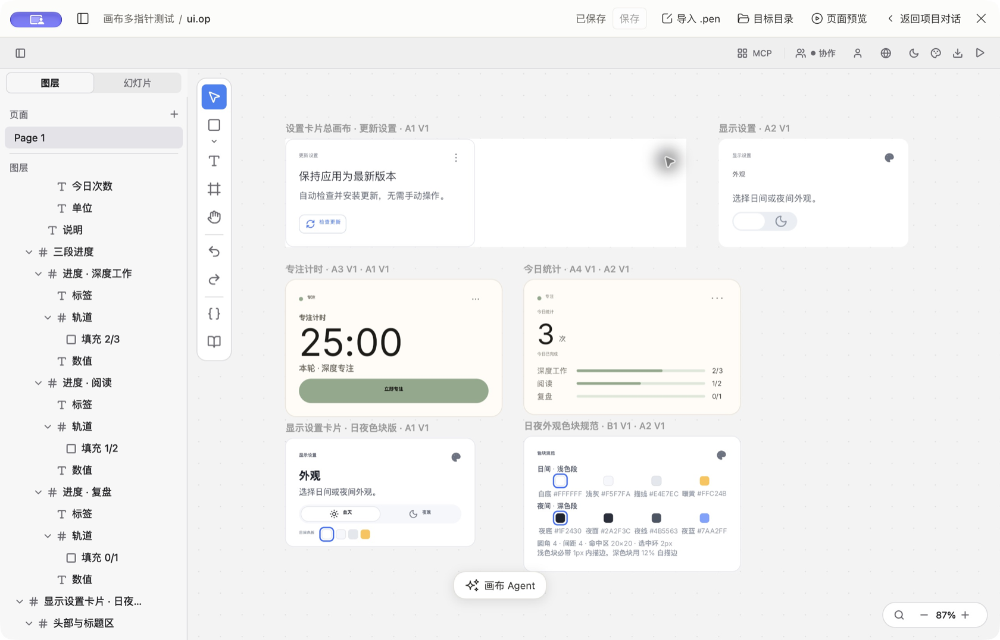
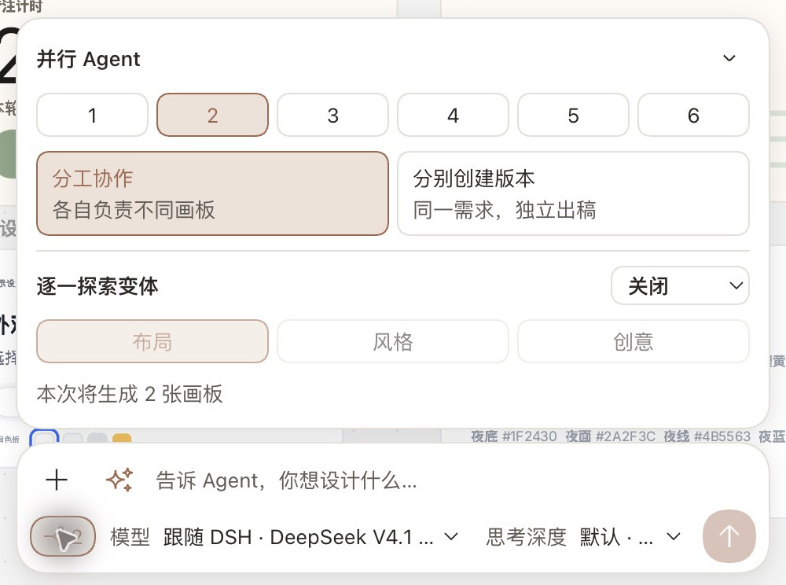
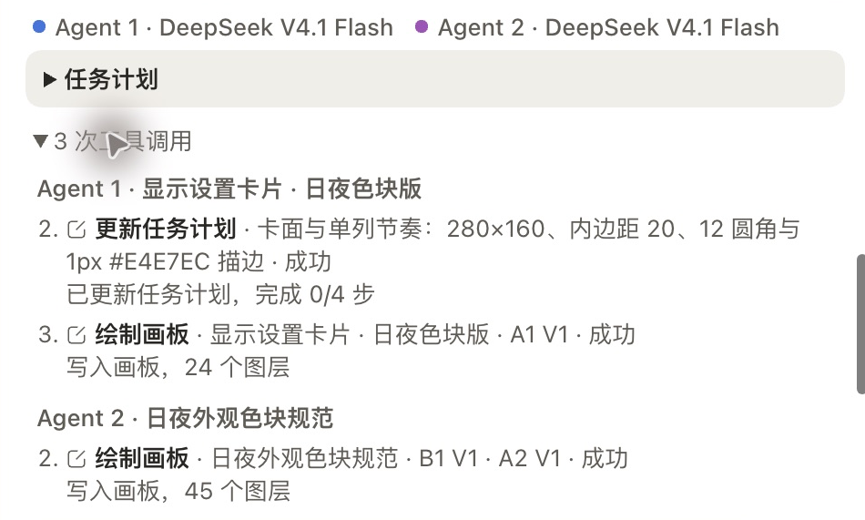
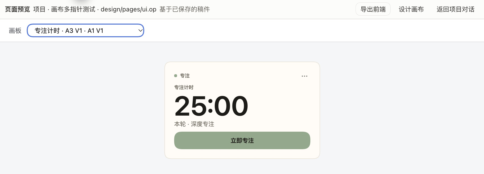

# DSH UI Editor

[简体中文](README.md) · **English**

DSH UI Editor brings an editable OpenPencil canvas into your DeepSeek Harness desktop project. Ask two agents to sketch different settings screens and compare them side by side. Like the layout of the first one but want a different button? Select it and ask, “Use a refresh icon and change the label to ‘Check for updates.’” The edited layers stay in your project, ready to preview or export as a React page.

[Try the focus timer walkthrough](#design-two-cards-for-a-focus-app) · [Run the included demo](#set-up-the-development-environment) · [Build and install the desktop plugin](#build-and-install-the-desktop-plugin)



## When to use it

- **Bring two options to a design review.** Give both agents the same brief and a different emphasis. One timer design might lead with time remaining, the other with today's progress. Compare both on the canvas and keep editing the one you prefer.
- **Make a small change to an existing Pencil design.** Import a `.pen` file, select a layer, and ask what it says. Have the agent revise its copy, icon, or styling. You can still adjust that same layer by hand.
- **Hook up a design you've settled on.** Preview the focus timer card, export the React page, and connect its “Focus now” button to your existing timer function. The artboard, layer IDs, and frontend files all belong to the same project.

## Design two cards for a focus app

### 1. Describe the UI on the canvas

Open **UI Design Compiler** (UI 设计编译器) in the DSH project sidebar, then click **Canvas Agent** (画布 Agent) at the bottom of the canvas. Try this prompt.

> Design two cards for a focus app. The first should show 25:00 and a “Focus now” button. The second should show how many sessions I finished today and my progress on deep work, reading, and review. Use the same color palette on both cards. Keep the headings, numbers, and buttons on separate, editable layers.

To start from an existing design, click **Import .pen** (导入 .pen) in the toolbar or drag a Pencil JSON file onto the canvas. Its artboards and layers are added to the current page. If the design uses local images, the editor will ask you to locate them. You can also use **+** in the chat to attach a design or reference image and ask which artboards it contains or what a particular layer says.

### 2. Split the work and revise as you go

Open the parallel settings at the bottom of the chat input. Select **2** and **Split the work** (分工协作) to give each agent a card. To compare two takes on the same card, choose **Create separate versions** (分别创建版本). You can work with 1–6 agents and choose the model and reasoning depth. **Explore variants** (逐一探索变体) adds 1–5 rounds after the first draft to try changes in layout, style, or creative direction.



Each agent has a pointer that marks where it is working on the canvas. While the agents draw, add “Use sage green as the primary color on both cards” in the same chat. For a smaller change, select the button and ask “Change this label to ‘Start session’,” or edit the layer yourself. Each finished artboard appears on the current page.

Expand **Task plan** (任务计划) to see how the agents divided the work and **Tool calls** (工具调用) to see what they actually changed. In this appearance-settings example, one agent drew a 24-layer settings card while the other drew a 45-layer color palette.



### 3. Preview a card and connect its button

After you pause editing, the toolbar shows **Saved** (已保存). Click **Page preview** (页面预览) to save any pending edits and open the preview. Use the artboard menu to inspect one design at a time. Here the focus timer shows 25:00 and the green “Focus now” button.



Click **Export frontend** (导出前端). In a standard project, the plugin writes three files to `design/generated/<content-hash>/`.

| File | How to use it |
| --- | --- |
| `UiPage.tsx` | The React page component. Pass a `boardId` to show a particular artboard. It defaults to the last visible artboard. |
| `CanvasFramePreview.tsx` | Renders the layers and passes button clicks to your application code. |
| `boards.json` | Contains the exported artboards, layer IDs, and styles. Look up the control you want to connect here. |

For example, name the button container `Focus now button`. When someone clicks it, the exported component passes its layer ID and name to your `onAction` handler. Use that ID to call your app’s timer function.

## Project files and canvas chats

- **Designs and assets.** By default, the project stores its design in `design/pages/ui.op` and uploads in `design/assets/`. Open **Target folders** (目标目录) in the toolbar to change these locations. The settings live in `.dsh/ui-compiler/config.json`. Identical uploads share a file by content hash. You can also save manually from the toolbar.
- **Canvas chats.** Chats share the same design but keep separate histories. Choose **New chat** (新会话) to discuss another idea. Drag the top edge of the chat panel to see more messages, or collapse it to get more drawing space. Each project supports up to 20 chats and retains the latest 60 exchanges per chat in `.dsh/ui-compiler/conversations.json`. The first time you open a project with an older `ui.history.json`, the plugin migrates it to the new format.
- **Reference images and fonts.** Insert a reference image directly as an image layer. When opening a saved design, the editor loads the bundled Noto Sans SC, IBM Plex Mono, and Newsreader fonts as needed and preserves font-variable bindings from Pencil files.

## Canvas tools in project chat

With the project’s canvas open, the main DSH agent can use these six tools from the project chat.

| Tool | What it does |
| --- | --- |
| `uic_canvas_select` | Select a node by ID or layer name, or list the top-level artboards and current selection. |
| `uic_canvas_draw` | Draw a rectangle, ellipse, text layer, or empty frame at a given position. Set the fill, corner radius, or font size. |
| `uic_canvas_move` | Move or resize a layer by node ID. |
| `uic_canvas_image` | Insert an image uploaded to the project as an image layer. |
| `uic_canvas_read` | Read layers, text, and styles by selection, node ID, or keyword. |
| `uic_canvas_edit` | Batch changes to text, styles, or structure by layer ID using the most recently read page revision. |

Edits appear on the live canvas and automatically save to the project’s `.op` file. Use `uic_canvas_select` to point to an existing layer.

## Set up the development environment

Use Node.js 24 and pnpm 11. From the repository root, install the locked dependencies, generate the calibration page with its component list and theme tokens, and run the checks.

```sh
pnpm install --frozen-lockfile
pnpm run prepare:demo
pnpm run check
pnpm exec tsc --noEmit -p harness/tsconfig.json
pnpm test
```

The [MCP Center example](examples/mcp-center.op) is a synthetic test design covering default, loading, empty, and error states. On the first run, `prepare:demo` copies it to `design/pages/mcp-center.op`. If a design already exists at that path, the script uses it.

Start the example preview with the command below. To see the compiler commands, run `pnpm uic --help`.

```sh
pnpm exec vite --config harness/vite.config.ts
```

## Build and install the desktop plugin

The desktop integration builds `0.1.0-rc.15.uic.39` from `@zseven-w/dsh-openpencil@0.1.0-rc.15`. The builder checks the upstream package name and version and verifies the SHA-256 hashes of both entry files. After running `prepare:demo`, run the following commands from the repository root.

```sh
mkdir -p artifacts/upstream
npm pack @zseven-w/dsh-openpencil@0.1.0-rc.15 --ignore-scripts --pack-destination artifacts/upstream
tar -xzf artifacts/upstream/zseven-w-dsh-openpencil-0.1.0-rc.15.tgz -C artifacts/upstream
node dsh-entry/build.mjs artifacts/upstream/package
```

The package is written to `artifacts/dsh-sidebar-button/`. This build is intended for local use and records its build directory to identify the calibration project. The preview worker runs with the Node.js runtime bundled with the macOS DSH app. The integration targets DSH UI dependencies at version `0.2.2-alpha.2`.

On macOS, save your work and quit DSH. From the same directory, run the desktop app’s bundled CLI to install the plugin. Reopen DSH, select a project on your local disk, and click **UI Design Compiler** (UI 设计编译器) in the project sidebar.

```sh
DSH_RESOURCES="/Applications/DeepSeek Harness.app/Contents/Resources/runtime"
DSH_DESKTOP_PRIMARY_RUNTIME_DIR="$DSH_RESOURCES/primary-runtime" "$DSH_RESOURCES/cli/bin/dsh" plugin --profile desktop add "file:$PWD/artifacts/dsh-sidebar-button/zseven-w-dsh-openpencil-0.1.0-rc.15.uic.39.tgz" --config.auto-install-peers=false
```

The [third-party licenses](third-party-licenses/) cover the upstream OpenPencil plugin, DSH UI primitives, and themes. Third-party runtime dependencies are distributed under the terms included with each package.
