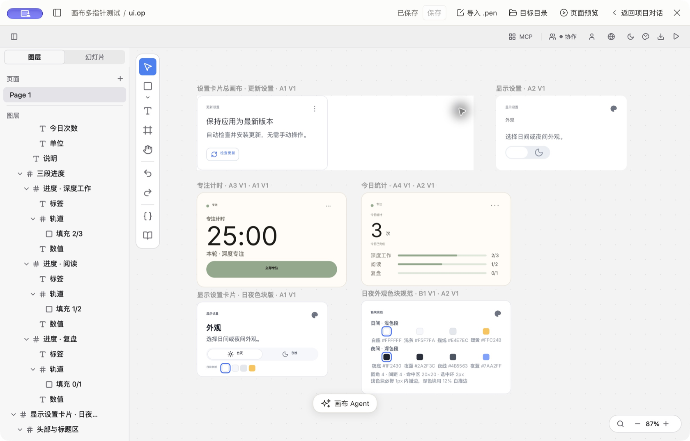
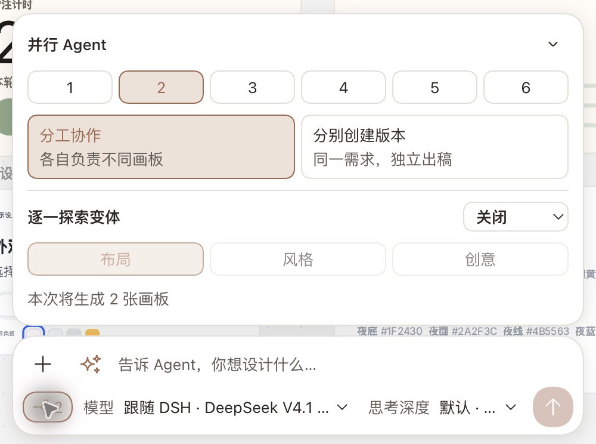
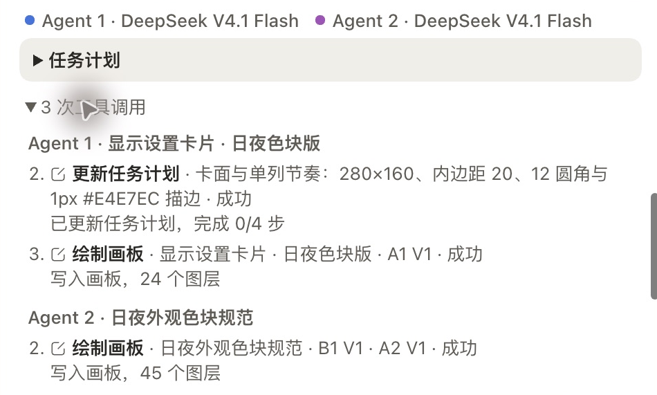
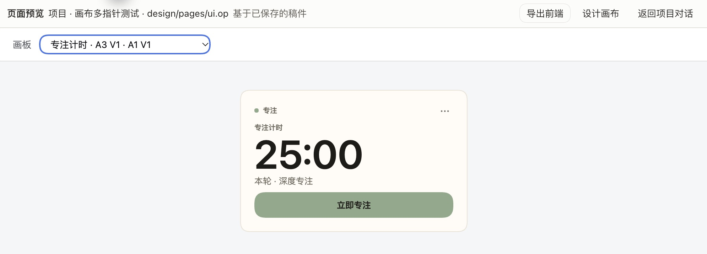

# DSH UI 编辑器

**简体中文** · [English](README.en.md)

DSH UI 编辑器把 OpenPencil 画布放进 DeepSeek Harness 桌面版的项目里。你可以让两个 Agent 各画一版设置页，把方案并排放在画布上。喜欢第一版的布局，但想换个按钮？选中它，告诉 Agent「换成刷新图标，文字改成『检查更新』」。改好的图层会保存在项目里，可以直接预览，也可以导出为 React 页面。

[在 DSH 内快速安装](#快速安装) · [试画一个专注计时器](#用两张卡片走一遍) · [运行仓库自带的示例](#准备开发环境) · [构建和安装桌面插件](#构建桌面插件)



## 快速安装

在 **苹果菜单 → 关于本机** 查看芯片或处理器，按下面的型号复制对应安装地址。两个包都内置了匹配的 OpenPencil 画布运行时和页面预览工具。

**Intel Mac**（处理器显示 Intel）· `x64` · DSH 桌面版 `0.2.1-rc.4`

```text
https://github.com/003jia/dsh-ui-compiler/releases/download/v0.1.0-rc.15.uic.41/dsh-ui-editor-mac-x64.tgz
```

**Apple 芯片 Mac**（芯片显示 Apple M 系列）· `arm64` · DSH 桌面版 `0.2.2-rc.5`

```text
https://github.com/003jia/dsh-ui-compiler/releases/download/v0.1.0-rc.15.uic.40/dsh-ui-editor-mac-arm64.tgz
```

1. 在 DSH 打开 **插件 → 添加插件**，把对应的地址粘贴到 **包名或地址**，点击 **安装**。
2. 点击 **立即启用**，打开本地项目，在侧栏选择 **UI 设计编译器**。

也可以下载 `.tgz`，将文件的绝对路径粘贴到同一输入框。下载页提供 SHA-256 校验文件。[Intel Mac 下载页](https://github.com/003jia/dsh-ui-compiler/releases/tag/v0.1.0-rc.15.uic.41) · [Apple 芯片 Mac 下载页](https://github.com/003jia/dsh-ui-compiler/releases/tag/v0.1.0-rc.15.uic.40)

Intel 包已在 Apple 芯片 Mac 上用 Rosetta 运行官方 x64 版 DSH，验证了安装、启用、画布读稿、页面预览和 React 导出。实体 Intel Mac 尚待实机验证。

## 什么时候用它

- **评审前想多看一种方案。** 让两个 Agent 为同一需求分别出稿，例如「一版突出剩余时间，一版突出今日进度」。在同一张画布上比较，选中想继续改的那一版。
- **已有 Pencil 稿，只需要改几处。** 导入 `.pen`，点中某个图层问「这里现在写的什么？」再让 Agent 改文案、图标或样式。手动调整的也是这份稿件。
- **界面定了，马上要接业务。** 预览「专注计时」卡片，导出 React 页面，让「立即专注」按钮调用项目已有的计时函数。画板、图层 ID 和前端文件都在同一个项目里。

## 用两张卡片走一遍

### 1. 在画布里提需求

打开 DSH 项目侧栏里的「UI 设计编译器」，点画布底部的「画布 Agent」，试着发这条需求。

> 给专注应用画两张卡片。第一张显示 25:00 和一个「立即专注」按钮，第二张显示今天完成了几次，以及深度工作、阅读和复盘的进度。两张卡用同一套颜色，标题、数字和按钮各自保留为可编辑图层。

已有设计也可以接着做。点顶栏的「导入 .pen」，或将 Pencil JSON 稿件拖入画布，画板和图层会追加到当前页。稿件引用本地图片时，按提示补选配图。在聊天框用「＋」附上稿件或参考图，可以先问 Agent 稿件里有哪些画板、某一层写了什么。

### 2. 让 Agent 分工，边看边改

点输入框底部的并行设置，选择 **2 位 Agent → 分工协作**，让它们各画一张卡。想比较同一张卡的不同做法，就选「分别创建版本」。支持 1–6 位 Agent，可选择模型和思考深度。「逐一探索变体」可以在初稿之后追加 1–5 轮，逐轮调整布局、风格或创意。



运行时，画布上的指针标出各个 Agent 的工作区域。在原输入框追加「把两张卡的主色调改成鼠尾草绿」即可继续调整。只想改一处时，可以选中按钮再说「把这层的文字改成『开始专注』」，也可以直接手动编辑。每张画板完成后都会写回当前页。

展开「任务计划」可看分工，展开「工具调用」可看实际执行结果。下面是同一项目里的一次外观设置任务，两位 Agent 分别写入了一张含 24 个图层的设置卡片和一张含 45 个图层的色块规范画板。



### 3. 预览页面，接上业务逻辑

编辑短暂停顿后，顶栏会显示「已保存」。点「页面预览」会先保存当前改动，再用下拉框切换画板。图中选中的是画布上的「专注计时」，可以单独检查时间、文案和按钮。



点「导出前端」，普通项目会在 `design/generated/<内容哈希>/` 中写入三个文件。

| 文件 | 在项目中怎么用 |
| --- | --- |
| `UiPage.tsx` | React 页面入口。传入 `boardId` 显示指定画板，省略时显示最后一张可见画板。 |
| `CanvasFramePreview.tsx` | 将图层渲染成页面，并把按钮点击交给业务层。 |
| `boards.json` | 保存导出的画板、图层 ID 和样式，可用来查找要接入的控件。 |

例如，把按钮容器命名为「立即专注按钮」，导出的页面就能通过 `onAction` 把点击的图层 ID 和名称交给你的代码。按这个 ID 调用项目里的计时函数，「立即专注」就能启动真正的计时。

## 项目文件与画布对话

- **设计稿和资源**默认写入项目的 `design/pages/ui.op` 和 `design/assets/`。顶栏「目标目录」可调整保存位置，配置写入 `.dsh/ui-compiler/config.json`。相同上传文件按内容哈希复用。顶栏也可以手动保存。
- **画布会话**共享同一份设计稿，各自保留聊天记录。点「新会话」可单独讨论另一个方案，拖动对话框顶边可以调高消息区，收起后就能腾出画布空间。每个项目支持最多 20 个会话，每个会话保留最近 60 轮，保存在 `.dsh/ui-compiler/conversations.json`。已有的 `ui.history.json` 会在首次打开时迁移。
- **参考图**可以直接插入为图片图层。打开已保存的稿件时，编辑器会按需加载随插件提供的 Noto Sans SC、IBM Plex Mono 和 Newsreader，并保留 Pencil 稿件中的字体变量绑定。

## 在项目对话中调用画布工具

回到项目对话后，DSH 主 Agent 也可以通过下面六个工具操作该项目已打开的画布。

| 工具 | 作用 |
| --- | --- |
| `uic_canvas_select` | 按节点 id 或图层名选中节点，或列出当前页的顶层画板和选区。 |
| `uic_canvas_draw` | 在指定位置画矩形、椭圆、文字或空 frame，支持填充色、圆角和字号。 |
| `uic_canvas_move` | 按节点 id 移动或缩放已有图层。 |
| `uic_canvas_image` | 把用户上传到本项目的图片插入为图片图层。 |
| `uic_canvas_read` | 按选区、节点 ID 或关键词读取图层、文案与样式。 |
| `uic_canvas_edit` | 使用最近读取的页面版本，按图层 ID 批量修改文字、样式或结构。 |

修改会实时反映到画布上，并自动保存到当前项目的 `.op` 文件。需要指向已有图层时，使用 `uic_canvas_select`。

## 准备开发环境

使用 Node.js 24 和 pnpm 11。在仓库根目录安装锁定依赖，生成校准页及其依赖的组件清单和主题 token。

```sh
pnpm install --frozen-lockfile
pnpm run prepare:demo
pnpm run check
pnpm exec tsc --noEmit -p harness/tsconfig.json
pnpm test
```

仓库附带的 [MCP 中心示例](examples/mcp-center.op) 是用于测试的合成稿件，涵盖默认、加载、空和错误状态。首次运行 `prepare:demo` 时，脚本将示例复制到 `design/pages/mcp-center.op`。如果已有同名稿件，脚本会保留并使用现有稿件。

用以下命令启动示例预览，或者用 `pnpm uic --help` 查看编译器命令。

```sh
pnpm exec vite --config harness/vite.config.ts
```

## 构建桌面插件

两个 macOS 包都基于 `@zseven-w/dsh-openpencil@0.1.0-rc.15`。在仓库根目录运行 `prepare:demo`，再解包共用的上游插件。构建时会校验上游代码、内置运行时和原生工具。

```sh
mkdir -p artifacts/upstream
npm pack @zseven-w/dsh-openpencil@0.1.0-rc.15 --ignore-scripts --pack-destination artifacts/upstream
tar -xzf artifacts/upstream/zseven-w-dsh-openpencil-0.1.0-rc.15.tgz -C artifacts/upstream
```

**构建 Intel Mac 包（uic.41）**

```sh
mkdir -p artifacts/native-mac-x64 artifacts/esbuild-mac-x64
npm pack @zseven-w/dsh-openpencil-darwin-x64@0.1.0-rc.15 --ignore-scripts --pack-destination artifacts/native-mac-x64
tar -xzf artifacts/native-mac-x64/zseven-w-dsh-openpencil-darwin-x64-0.1.0-rc.15.tgz -C artifacts/native-mac-x64
npm pack @esbuild/darwin-x64@0.25.12 --ignore-scripts --pack-destination artifacts/esbuild-mac-x64
tar -xzf artifacts/esbuild-mac-x64/esbuild-darwin-x64-0.25.12.tgz -C artifacts/esbuild-mac-x64
node dsh-entry/build.mjs artifacts/upstream/package --bundle-darwin-x64 artifacts/native-mac-x64/package artifacts/esbuild-mac-x64/package
```

**在 Apple 芯片 Mac 上构建 arm64 包（uic.40）**

```sh
mkdir -p artifacts/native-mac-arm64
npm pack @zseven-w/dsh-openpencil-darwin-arm64@0.1.0-rc.15 --ignore-scripts --pack-destination artifacts/native-mac-arm64
tar -xzf artifacts/native-mac-arm64/zseven-w-dsh-openpencil-darwin-arm64-0.1.0-rc.15.tgz -C artifacts/native-mac-arm64
node dsh-entry/build.mjs artifacts/upstream/package --bundle-darwin-arm64 artifacts/native-mac-arm64/package
```

构建产物位于 `artifacts/dsh-sidebar-button/`。将目标架构对应的 `.tgz` 绝对路径填入 DSH 的 **插件 → 添加插件**，即可安装本地构建。

上游 OpenPencil 插件、DSH UI 原语和主题的许可见 [第三方许可](third-party-licenses/)。第三方运行时依赖按各自软件包附带的条款分发。
